# GHCP Proxy 多企业版管理员手册

适用版本：多企业版本线（镜像 tag `multi-*`，四个服务的 `/healthz` 返回 `"releaseLine": "multi"`）。
读者：第一次接触 Console 的客户管理员。本手册按“要完成的管理任务”组织，每个任务给出步骤、截图、预期结果和常见错误。

- 页面上每个字段、每一列的逐项解释见附录 [User Pool 页面逐项说明](../user-pool-console-guide.md)，本手册不重复。
- registry 字段全集见 [多企业 registry 配置参考](../multi-enterprise-registry.md)；环境变量全集见 [配置参考](../user-pool-configuration-reference.md)。
- 截图全部来自本地隔离环境，只有合成数据（`default`、`contoso-eu`、`fabrikam` 三个虚构企业，账号名来自产品内置的虚构姓名目录，key 为 `sk-example-*`）。截图的复现方法见[附录 B](#附录-b刷新截图)。图中的红框和数字是截图时加的标注，不是界面的一部分。

## 目录

- [0. 先认识几个对象](#0-先认识几个对象)
- [任务 1：登录 Console，理解企业选择器](#任务-1登录-console理解企业选择器)
- [任务 2：每日巡检](#任务-2每日巡检)
- [任务 3：首次开池与新增企业](#任务-3首次开池与新增企业)
- [任务 4：调整全局 Ready idle target、Lease TTL 与暂停预热](#任务-4调整全局-ready-idle-targetlease-ttl-与暂停预热)
- [任务 5：企业 cap、Drain 与 Resume](#任务-5企业-capdrain-与-resume)
- [任务 6：处理异常成员（Disable / Retry / Resume）](#任务-6处理异常成员disable--retry--resume)
- [任务 7：查某个用户落在哪个企业、哪个账号，并释放租约](#任务-7查某个用户落在哪个企业哪个账号并释放租约)
- [任务 8：SSO 用户、席位、Proxy 账号与登录任务](#任务-8sso-用户席位proxy-账号与登录任务)
- [任务 9：Models 页面](#任务-9models-页面)
- [任务 10：用户投诉时怎么看 Request Stats、AI Credits 和 Error Diagnostics](#任务-10用户投诉时怎么看-request-statsai-credits-和-error-diagnostics)
- [任务 11：LiteLLM 侧（没有界面）](#任务-11litellm-侧没有界面)
- [任务 12：故障排查速查表](#任务-12故障排查速查表)
- [附录 A：本手册核对过的行为](#附录-a本手册核对过的行为)
- [附录 B：刷新截图](#附录-b刷新截图)

## 0. 先认识几个对象

| 对象 | 是什么 | 在 Console 哪里看 |
| --- | --- | --- |
| 企业（enterprise） | registry 中的一个 GitHub 企业，内部 ID 例如 `default`、`contoso-eu`、`fabrikam`。可以是 github.com，也可以是 GHE.com（`<子域>.ghe.com`）。 | 页头 **Enterprise** 选择器、**Pool overview** 企业表 |
| 调用方（caller） | LiteLLM 认证通过的一把 virtual key。Proxy 只看到它的 hash：`sha256:<64 位小写十六进制>`，看不到原始 key、别名或邮箱。 | **Pool members** 的 Caller key hash 列 |
| 池成员（member / account） | 后台替调用方执行模型请求的 GHCP 账号，属于且只属于一个企业。 | **Pool members** → Accounts |
| 租约（lease） | 调用方独占一个池成员的绑定。首次请求先得到临时租约（provisional，默认 5 分钟），第一次完整成功推理后变为正式租约（active），默认 48 小时，每次成功推理续期。 | **Pool members** → Leases |
| 生命周期 | 企业在账号池中的状态：`draft`（新加入，不补货不分配）→ `active`（参与补货和分配）→ `draining`（排空：不新建租约、不补货，已有租约保留）→ 可 Resume 回 `active`。 | **Pool overview** 企业表 State 列 |

调用方**不指定企业**。新调用方第一次请求时由调度选择企业，之后一直留在原企业、原成员上，直到租约释放或到期。

---

## 任务 1：登录 Console，理解企业选择器

### 1.1 第一次打开：创建管理员

Console 第一次启动、管理员文件（`ADMINS_FILE`，默认 `./data/admins.json`，Compose/K8s 中通常是 `/data/admins.json`）里还没有启用的管理员时，打开 Console 会看到 **Initialize Console**。

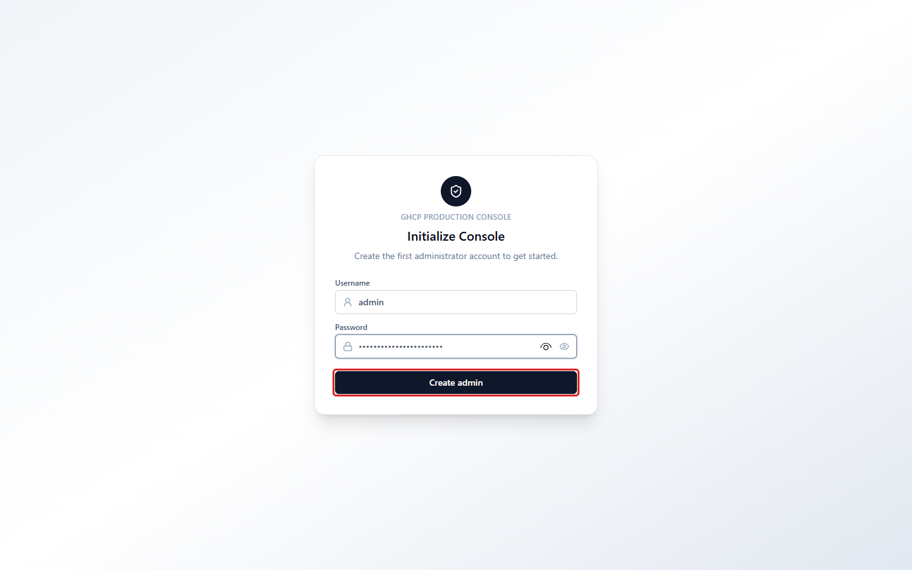

步骤：

1. 输入用户名（默认填好 `admin`，可改）和密码。
2. 点击 **Create admin**。成功后直接进入 Dashboard。

预期结果：`ADMINS_FILE` 中写入一条管理员记录（只保存加盐的 scrypt 哈希，不保存明文）。之后再打开 Console 显示 **Admin Login**。

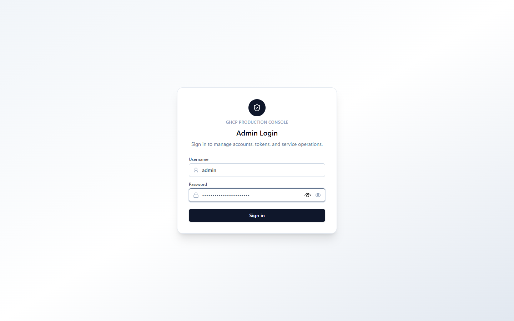

常见错误：

- **管理员文件挂错卷或被清空**：Console 判断“未初始化”，会重新出现 Initialize 页面，第一个打开页面的人就能创建管理员。部署时把 `ADMINS_FILE` 放在持久卷上并备份；Console 不应在初始化前暴露给不受信任的网络。
- **想新增第二个管理员**：当前 Console 只在初始化时创建一个管理员，界面上没有“添加管理员”的功能。
- **忘记密码**：界面没有找回功能；只能由运维从备份恢复 `ADMINS_FILE`。登录后可在 **Settings → Console administrator password** 修改密码（见下图最底部卡片）。
- 会话有效期约 8 小时（源码固定值），过期后页面提示 `Your Console session expired. Sign in again...`，重新登录即可。

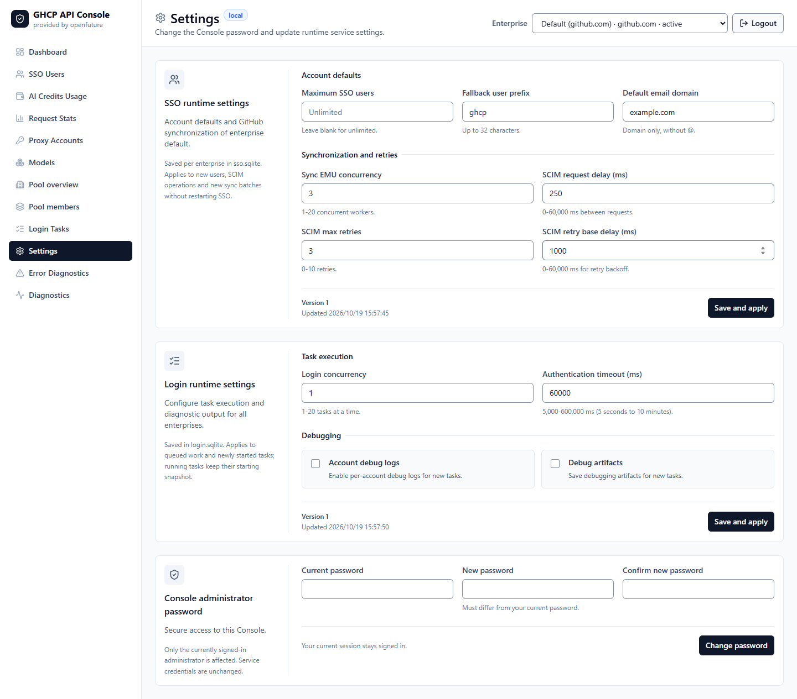

### 1.2 页面分类与企业选择器

左侧导航的页面分三类：

| 类型 | 页面 | 页头是否有 Enterprise 选择器 |
| --- | --- | --- |
| 全局 | Dashboard、Pool overview、Error Diagnostics | 没有，一次展示所有企业 |
| 按企业 | SSO Users、AI Credits Usage、Request Stats、Proxy Accounts、Models、Pool members、Login Tasks | 有，只显示和操作所选企业 |
| 混合 | Settings（SSO 设置按企业，Login 设置和管理员密码全局）、Diagnostics（检查所选企业的各服务接口） | 有 |

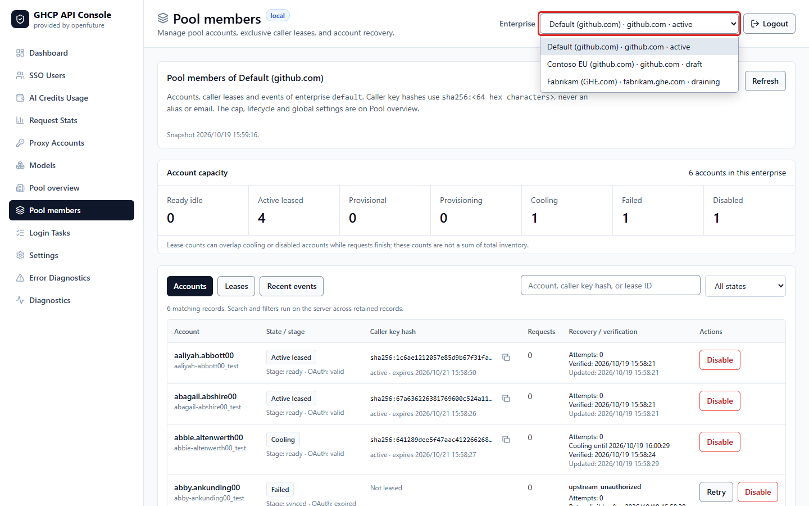

步骤：在按企业的页面，用页头 **Enterprise** 下拉框切换企业。

预期结果：

- 每个选项显示 `显示名 · GitHub 主机 · 状态`，状态为 `draft` / `active` / `draining`（直连模式显示 `direct`）。
- 所选企业保存在地址栏的 hash 中（`#/<页面>?e=<企业ID>`），刷新或复制链接后不变。没有 `e=` 时默认 `default`。
- 切换企业时页面重新加载，筛选条件、勾选和未保存的草稿都属于原企业，不会带到新企业。

常见错误：

- **以为选择器是权限边界**。不是：所有 Console 管理员都能管理所有企业。
- **选择器里的状态没变**。选择器的企业列表在浏览器加载 Console 时读取一次；在 Pool overview 里 Activate、Drain、Resume 之后，选择器仍显示旧状态，按浏览器刷新（F5）后才更新。企业表和 Dashboard 的状态是最新的。
- **地址里的企业不存在**（例如书签里的旧 ID）：按企业的页面显示 `Enterprise "<id>" is not configured in Proxy. Choose an enterprise.`，不会自动换成别的企业。
- 标题旁的 `local` 只是界面标记，**不能用来判断是 mock 还是真实环境**。

---

## 任务 2：每日巡检

建议每天按 Dashboard → Pool overview → Pool members 的顺序看一遍。

### 2.1 Dashboard

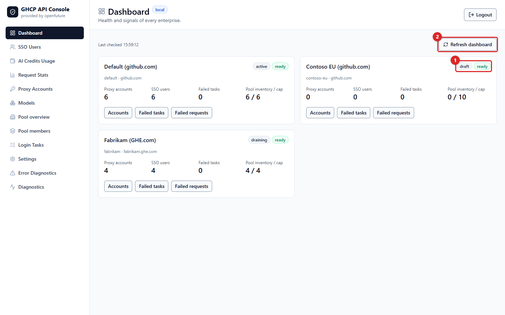

每个企业一张卡片：

| 位置 | 看什么 | 正常值 |
| --- | --- | --- |
| 右上角两个徽章（图中 1） | 左：生命周期 `active` / `draft` / `draining`；右：就绪 `ready` / `not ready`（鼠标悬停显示阻塞项）/ `readiness unknown` | 在用的企业应为 `active` + `ready` |
| Proxy accounts / SSO users / Failed tasks | 该企业的 Proxy 账号数、SSO 用户数、失败的登录任务数；某个服务读不到时显示 `Unavailable` | Failed tasks 为 0 或不增长 |
| Pool inventory / cap | 该企业已登记的池成员数 / 该企业 cap | 接近 cap 时考虑扩容（任务 5） |
| 按钮 Accounts / Failed tasks / Failed requests | 直接跳到该企业对应页面并带好筛选条件 | — |

**Refresh dashboard**（图中 2）只重新读取数据，不会触发补池或重新授权。

### 2.2 Pool overview：Attention needed

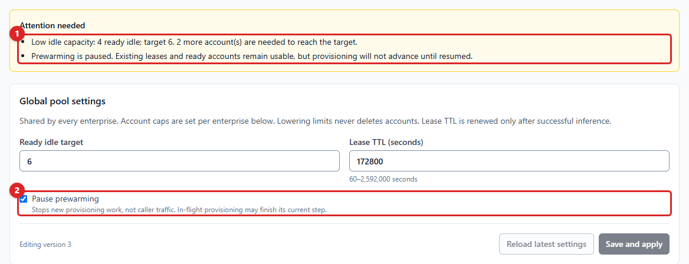

黄色 **Attention needed** 是针对整个池（所有企业合计）的提示：

| 提示 | 含义 | 要不要处理 |
| --- | --- | --- |
| `Low idle capacity: X ready idle; target Y. Z more account(s) are needed...` | 合计 Ready idle 低于全局目标 | 先看是否在补货（Provisioning 不为 0）、是否暂停、各 `active` 企业是否已到 cap（见任务 4、5）。正在补货时属正常 |
| `No ready idle accounts. New caller keys cannot acquire an account...` | 当前没有可立即分配的成员 | 新用户会收到 429 `pool_exhausted`；已有租约的用户不受影响 |
| `Prewarming is paused...` | 全局暂停预热已开启 | 确认是否是有意暂停（任务 4.3） |

注意：Pool overview 顶部的合计数（`All enterprises: N accounts, X ready idle, Y leased`）和这里的提示**包含 `draining` 企业的成员**。`draining` 企业的空闲成员不会分给新用户，所以“有 ready idle 但新用户仍 429”时，先看这些空闲成员属于哪个企业。

### 2.3 企业是否就绪、服务是否连通

- **Pool overview → Enterprises 表的 Blockers 列**：`None` 表示 Proxy、SSO、Login 三方对该企业的配置一致且没有缺项；否则列出阻塞项代码（处理方法见任务 3.4）。`Readiness unknown` 表示本次没能在时限内完成三方比对，稍后 Refresh。
- **Diagnostics** 页面：检查 Console 到 Proxy、SSO、Login 各接口是否连通、内部令牌是否一致。全部 `OK` 为正常。

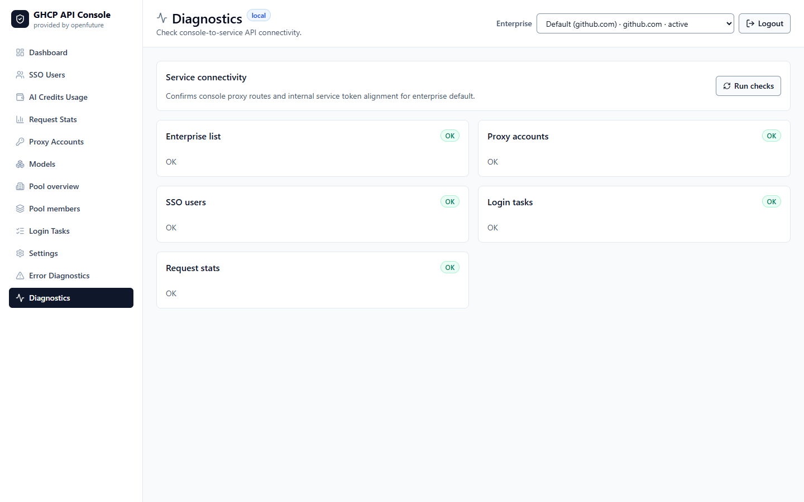

### 2.4 Pool members：有没有 Failed、Cooling、Disabled

在页头选择企业，看 **Account capacity** 一行七个数字（详细含义见附录 [User Pool 页面逐项说明](../user-pool-console-guide.md) 第 5.2 节）。Failed 不为 0 时按任务 6 处理。

---

## 任务 3：首次开池与新增企业

### 3.1 整体流程

```text
GitHub 侧准备 → 准备 secret 文件 → 编辑 registry → 依次重启 Proxy、SSO、Login
→ 新企业以 draft 出现 → 清除 Blockers → Edit cap → Activate → 观察开户 → 用测试 key 验证
```

新企业在三方都可见并就绪之前一直是 `draft`，不会被调度，所以可以逐个重启服务，已有企业不受影响。

### 3.2 编辑 registry（github.com 与 GHE.com 的区别）

registry 是一个 JSON 文件，由 `ENTERPRISE_REGISTRY_FILE` 指定，**只读挂载到 Proxy、SSO、Login 三个服务**（Console 不读它）。文件中只能写 secret 的**引用**（`{"file": "/绝对路径"}` 或 `{"env": "变量名"}`），不能写值。示例（全部为占位值）：

```json
{
  "version": 1,
  "enterprises": [
    {
      "id": "contoso-eu",
      "displayName": "Contoso EU (github.com)",
      "github": { "baseUrl": "https://github.com", "slug": "contoso-eu", "shortcode": "contoso" },
      "sso": {
        "signingCert": { "file": "/run/secrets/contoso-eu/idp-cert.pem" },
        "signingKey": { "file": "/run/secrets/contoso-eu/idp-key.pem" },
        "sessionSecret": { "file": "/run/secrets/contoso-eu/session-secret" },
        "scimToken": { "file": "/run/secrets/contoso-eu/scim-token" },
        "seatPat": { "file": "/run/secrets/contoso-eu/seat-pat" },
        "defaultUserPassword": { "file": "/run/secrets/contoso-eu/default-password" }
      },
      "pool": { "accountDomain": "pool.contoso.example.com", "initialMaxAccounts": 10 }
    },
    {
      "id": "fabrikam",
      "displayName": "Fabrikam (GHE.com)",
      "github": { "baseUrl": "https://fabrikam.ghe.com", "slug": "fabrikam" },
      "sso": { "...": "同上，路径换成 /run/secrets/fabrikam/..." },
      "login": { "ssoProvider": "custom" },
      "pool": { "accountDomain": "pool.fabrikam.example.com" }
    }
  ]
}
```

| 字段 | github.com 企业 | GHE.com 企业（`https://<子域>.ghe.com`） |
| --- | --- | --- |
| `github.baseUrl` | `https://github.com` | `https://<子域>.ghe.com`，只写 origin，不带路径 |
| `github.apiBaseUrl` / `copilotApiBaseUrl` | 不写时为 `https://api.github.com`、`https://api.githubcopilot.com` | 不写时自动推导为 `https://api.<子域>.ghe.com`、`https://copilot-api.<子域>.ghe.com`；写了必须属于同一个子域 |
| `github.slug` | SSO 必填 | SSO 必填，**Login 也必填** |
| `github.shortcode` | 必填（3–8 位小写字母数字），GH 登录名会带 `_<shortcode>` 后缀 | **必须为空或不写**；GH 登录名不带后缀，最长 30 字符 |
| `pool.accountDomain` | 账号池模式必填；各企业不能重复 | 同左 |
| `pool.initialMaxAccounts` | 只在 Proxy **第一次**登记该企业时作为初始 cap；不写时为 10（`default` 取 `POOL_MAX_ACCOUNTS`） | 同左 |
| `modelsAdmin` | 可选，见任务 9 | 同左 |

下面几个字段**一旦该企业有数据就不能再改**，写之前务必核对：`id`；Proxy 的 `github.baseUrl`、`github.shortcode`、`pool.accountDomain`；SSO 的 `github.slug`。改了会导致服务以 `enterprise_identity_changed` 拒绝启动。

GitHub 侧需要在该企业的 SAML 设置中填写本部署的 IdP：Sign on URL `<SSO_PUBLIC_BASE_URL>/enterprises/<id>/sso`、Issuer `<SSO_PUBLIC_BASE_URL>/enterprises/<id>/metadata`、证书为该企业的 `sso.signingCert`。`default` 仍用根路径 `/sso`、`/metadata`，已有配置不用改。完整步骤见 [registry 配置参考第 9 节](../multi-enterprise-registry.md)。

> GHE.com 企业目前只在 mock 环境验证过（本手册的 `fabrikam` 也是 mock）。第一次接入真实 GHE.com 企业前，请先在预发布环境走完本任务。

### 3.3 重启服务，新企业以 draft 出现

registry **不支持热加载**。修改后重启 Proxy、SSO、Login（Kubernetes 中按正常滚动更新进行）。重启 Proxy 后，新企业出现在 Console 的企业列表中，状态为 `draft`，cap 为 `initialMaxAccounts`（默认 10）。

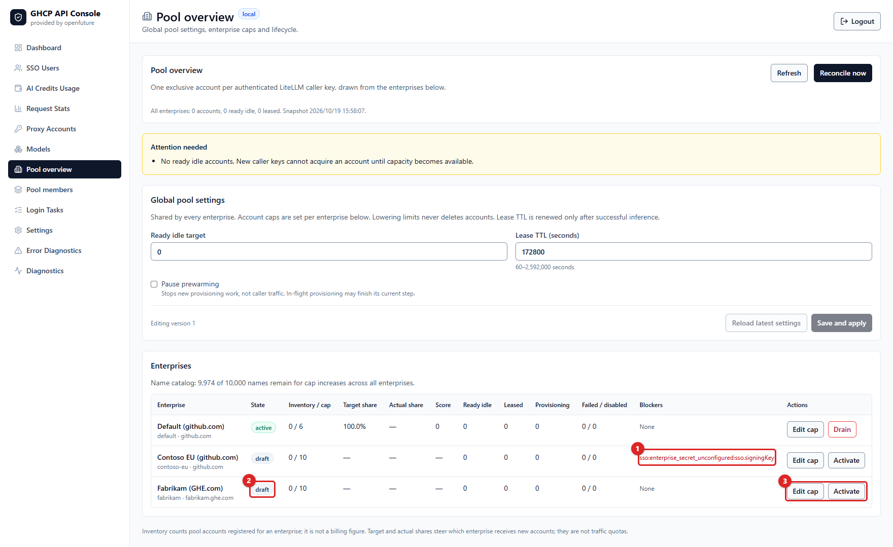

图中：

1. `contoso-eu` 的 Blockers 为 `sso:enterprise_secret_unconfigured:sso.signingKey`：SSO 读不到该企业的签名私钥文件。
2. `fabrikam` 为 `draft`，Blockers 为 `None`，可以激活。
3. `draft` 企业的操作只有 **Edit cap** 和 **Activate**（没有 Drain）。

### 3.4 清除阻塞项

| 阻塞项 | 含义 | 处理 |
| --- | --- | --- |
| `proxy:enterprise_field_missing:pool.accountDomain` | Proxy 缺必填字段（前缀 `sso:`、`login:` 表示对应服务） | 补字段，重启该服务 |
| `sso:enterprise_secret_unconfigured:sso.signingKey` | SSO 读不到该 secret（文件不存在、为空或环境变量未设置） | 补上 secret 文件；签名证书和私钥在 SSO 进程内缓存，需**重启 SSO** |
| `sso_missing` / `login_missing` | 该服务的 registry 里没有这个企业 | 通常是该服务还没重启或挂载的不是新文件 |
| `sso_unavailable` / `login_unavailable` | Proxy 访问不到该服务 | 检查服务和网络 |
| `*_mismatch`（如 `slug_mismatch`） | 三个服务看到的配置不一致 | 三个服务必须挂载同一份 registry |

就绪结果在每个 Proxy 副本中缓存（就绪 60 秒，未就绪 10 秒）。修好后稍等再点 Pool overview 的 **Refresh**。本手册环境中，补上 `contoso-eu` 的私钥文件并重启 SSO 后，Blockers 变为 `None`（见任务 5 的最终截图）。

**常见错误：未就绪就点 Activate。** Proxy 会实时重新比对三方配置，不满足时拒绝修改并列出阻塞项，状态保持 `draft`：

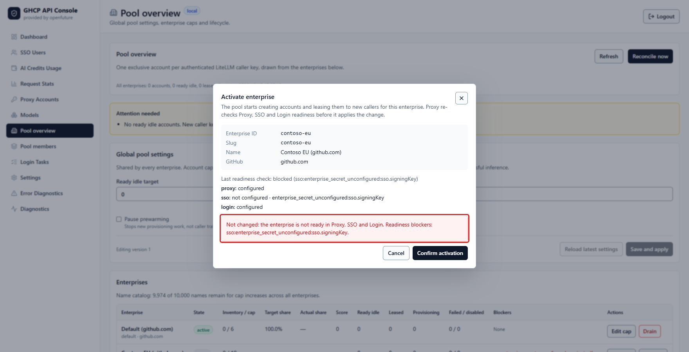

### 3.5 设置 cap，然后激活

1. 在企业表点该企业的 **Edit cap**，填入 **Enterprise maximum accounts**，点 **Save cap**。`draft` 企业也可以先改 cap。

   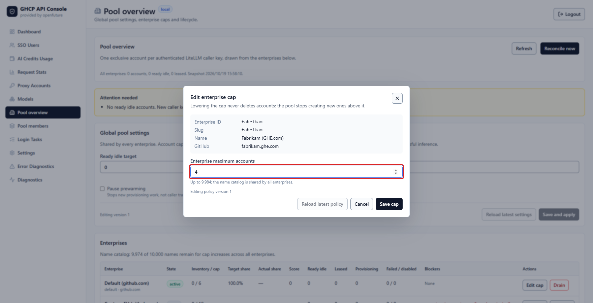

   - 允许范围是 1 到“当前 cap + 名称目录剩余量”。所有企业共用一个 10,000 个名字的目录，**所有企业 cap 之和不能超过 10,000**，超出返回 409 `name_capacity_exceeded`。
   - 对话框底部的 `Editing policy version N` 是防并发覆盖的版本号。别人先改过时提示 `The pool policy changed in another session`，草稿不丢；点 **Reload latest policy** 看最新值再决定。

2. 点 **Activate**。对话框先显示上一次三方就绪检查的明细（proxy / sso / login 是否 configured）。点 **Confirm activation**。

   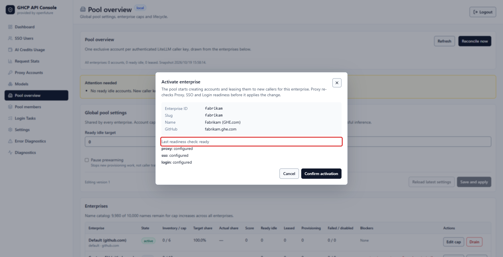

预期结果：提示 `Activate enterprise: fabrikam is now active.`，State 变为 `active`。如果全局 Ready idle target 大于 0 且未暂停，后台开始为该企业开户（SSO 用户 → SCIM → 席位 → 登录 → 预热 → Ready）。

### 3.6 新环境第一次开池的稳妥做法

1. 先保持全局 **Ready idle target = 0**（或勾选 Pause prewarming），新企业 cap 设小（例如 1）。
2. 确认该企业的 SSO、SCIM、席位、网络、预算都已就绪，SSO 剩余用户容量足够（Settings → Maximum SSO users）。
3. Activate，然后把 Ready idle target 设为 1、取消暂停，观察一个账号在 **Pool members** 中变为 `Ready idle`。
4. 用一把测试 virtual key 经 LiteLLM 调用成功后，再逐步调高 cap 和目标。

常见错误：

- 改了 registry 但只重启了一个服务 → `sso_missing` / `login_missing`。
- 已开过户的企业想从 registry 删除 → 服务启动失败（`enterprise_missing_from_registry`）。不再使用的企业请 **Drain**，必要时把 cap 调到最小。
- 一个企业不能回到 `draft`；`draft` 也不能直接 Drain。

---

## 任务 4：调整全局 Ready idle target、Lease TTL 与暂停预热

这三个设置在 **Pool overview → Global pool settings**，对所有企业生效。**企业 cap 不在这里**，在下面的企业表里按企业设置。

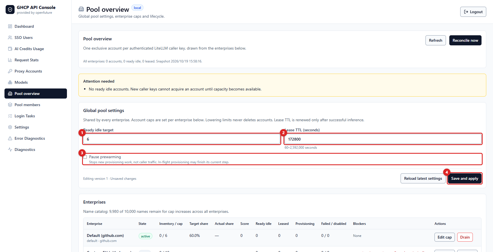

步骤：

1. 修改 **Ready idle target**（图中 1，范围 0–10,000）和/或 **Lease TTL (seconds)**（图中 2，范围 60–2,592,000 秒，默认 172,800 秒 = 48 小时）。
2. 需要暂停时勾选 **Pause prewarming**（图中 3）。
3. 点 **Save and apply**（图中 4）。不需要重启任何服务。

预期结果：提示 `Pool settings saved. Changes apply to future provisioning and lease renewals.`，`Editing version` 加 1。

### 4.1 补货规则（白话版）

后台 worker 反复做两件事：**算缺口**，**把缺口分给企业**。

**第一步：算缺口 D。**

```text
D = max(0, T − I − P)
```

- `T`：Ready idle target（全局目标空闲数）。
- `I`：所有 `active` 企业中，现在就能分给新用户的成员数（Ready idle）。
- `P`：所有 `active` 企业中“已经在路上”的成员数：正在开户的，失败但还会自动重试的（尝试次数少于 3 且不是需要人工处理的错误），以及刚换过凭据、还没完成验证的。
- 勾选了 Pause prewarming 时，D 一律为 0。

`draft`、`draining` 企业的成员不计入 I 和 P，也不会被补货。

**第二步：把 D 个新账号逐个分给企业。** 只在 `active`、已就绪、库存未到 cap 的企业中挑选，规则是“谁的库存占比最落后于它的 cap 占比，就先补谁”：

- 企业的 **Target share** = 该企业 cap ÷ 所有 `active` 企业 cap 之和；
- 企业的 **Actual share** = 该企业库存 ÷ 所有 `active` 企业库存之和（库存含开户中、失败、禁用的成员）；
- **Score** = `N × C_e − C × N_e`（C、N 为所有 `active` 企业的 cap 之和与库存之和，C_e、N_e 为该企业的），就是“目标占比 − 实际占比”放大后的整数。每补一个账号重新算一次，Score 最大的先补；所有企业都为空时，cap 最大的先补。

结果是各企业库存逐渐接近 cap 的比例。下图中 `default` cap 6、`fabrikam` cap 4，Target share 为 60% / 40%，补货后 Actual share 也是 60% / 40%，Score 都是 0：

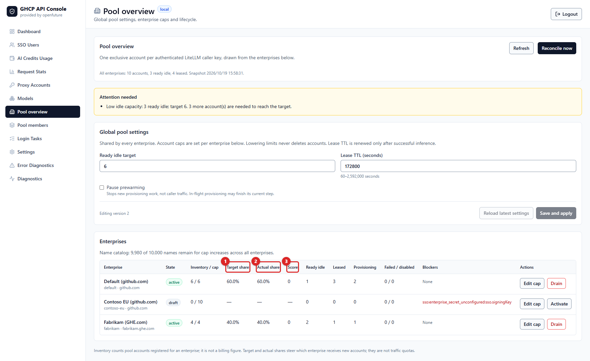

**新用户分到哪个企业**：在 `active` 且有 Ready idle 成员的企业中按同样的 Score 排序选择（分数相同按“调用方 hash + 企业 ID”的稳定散列排序），在该企业中取最久未更新状态的空闲成员。已经有租约的用户不重新选择。

### 4.2 全局目标可以大于单个企业的 cap

Ready idle target 是全局数，**可以大于任何一个企业的 cap**（截图中目标 6，`fabrikam` 的 cap 只有 4）。补货会在各企业到达 cap 时停止：

- 当所有 `active` 企业都到 cap 时，D 仍大于 0，但不会再开户，`Low idle capacity` 提示会一直存在。这时可以提高 cap、激活另一个企业，或调低目标。
- 空闲成员也占 Copilot 席位。目标设得越大，空闲占用的席位越多；调低目标或 cap **不会删除**已有账号、不退席位。

### 4.3 Lease TTL

- 正式租约在每次**完整成功**的推理后续期，到期时间 = 本次成功时间 + 当前 TTL。失败、中断、模型列表和 token 计数请求不续期。
- 修改 TTL 只影响之后的续期，不会批量改写已有租约的到期时间。
- 首次请求得到的临时租约（provisional）时长不在这里，由 Proxy 环境变量 `PROVISIONAL_LEASE_TTL_SECONDS`（默认 300 秒）决定。
- TTL 不是 GitHub/Copilot 凭据的有效期。

### 4.4 Pause prewarming

勾选并保存后：

- 停止的是后台**开户和修复**，不是用户流量。已有租约和 Ready 成员照常服务。
- 上游 401 后的自动重新授权也会暂停，失败成员一直保持 `Failed`，直到取消暂停或手工 Retry（本手册环境中实际观察到）。
- 已经被外部接受的单个步骤可能继续完成。
- 只想停一个企业时用该企业的 **Drain**（任务 5），不要用全局暂停。

常见错误：

- 改了数字但没点 **Save and apply**（底部显示 `Unsaved changes`）。
- 多人同时修改：后保存的人得到 `Settings changed in another session`，草稿保留；点 **Reload latest settings** 会丢弃草稿并载入最新值。
- 以为 **Reconcile now** 能绕过暂停或 cap：它只是让 worker 立即检查一次，仍然遵守暂停、cap 和生命周期，点击成功不代表账号已 Ready。

---

## 任务 5：企业 cap、Drain 与 Resume

### 5.1 调整 cap

方法同任务 3.5。要点：

- **提高 cap** 只是允许池在该企业开更多账号，不等于在 GitHub 购买了席位；先确认该企业的席位和预算。
- **降低 cap 不删除成员**，也不取消已登记的开户；可能暂时显示库存大于 cap，只是该企业不再增长。

### 5.2 Drain（排空一个企业）

适用：某个企业要停用、要维护，或要把新用户都导到其他企业。

步骤：在 Pool overview 企业表点该企业的 **Drain**，确认 **Confirm drain**。

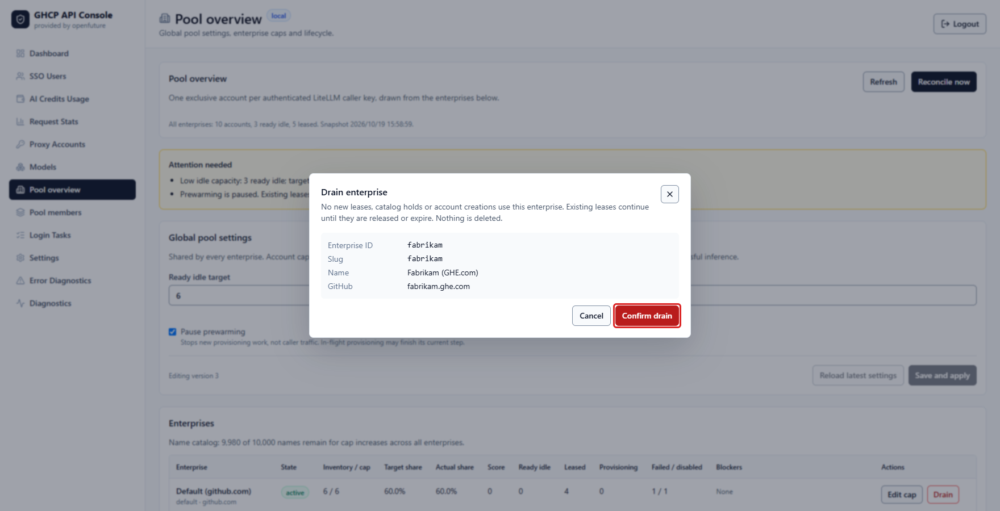

预期结果（在本手册环境中逐项验证过）：

| 对象 | Drain 之后 |
| --- | --- |
| 已有正式租约的用户 | **继续由原账号服务**，直到租约被释放或到期（验证：排空后原租约请求返回 200） |
| 租约释放或到期后的同一用户 | 不会回到排空中的企业；重新在 `active` 企业中分配。若 `active` 企业没有空闲成员，返回 429 `pool_exhausted`，即使排空企业里还有空闲成员（已验证） |
| 新用户 | 不会分到该企业 |
| 只持有模型目录请求占用（catalog hold）的用户 | 返回 503 `enterprise_draining`（带 `Retry-After: 30`），不会换企业 |
| 该企业的补货 | 停止；已在开户中的账号会继续完成 |
| 账号、席位 | 不删除任何东西。该企业的空闲账号仍占席位，并仍计入 Pool overview 的合计数 |

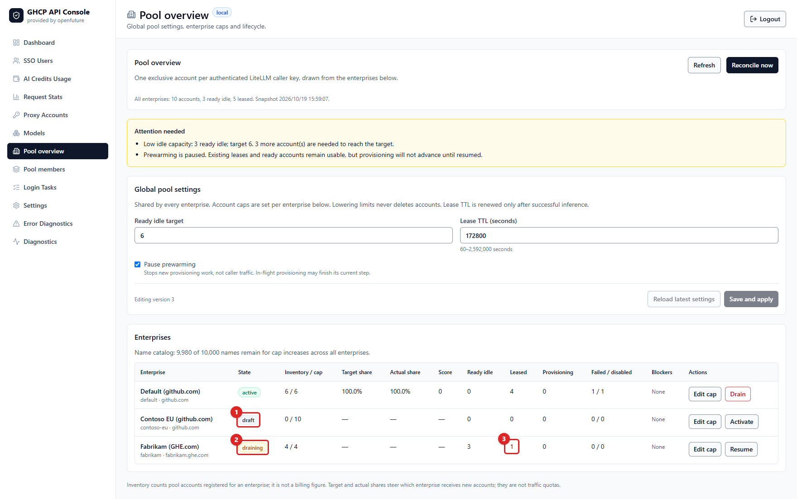

需要彻底停止某企业的调用时，除了 Drain，还要处理它的已有租约：等 TTL 到期，或在 **Pool members → Leases** 逐个 **Release**（任务 7）。

### 5.3 Resume

`draining` 企业的操作变为 **Resume**。点击后 Proxy 实时重新检查三方就绪，通过后恢复为 `active`；未就绪时返回 409 `enterprise_not_ready` 并列出阻塞项。

常见错误：

- 把 Pool overview 的 **Drain** 和“从负载均衡摘掉一个 Proxy 实例”混为一谈。前者按企业停止补货和分配，与 Proxy 进程无关。
- Drain 后看到合计 Ready idle 不为 0，但新用户仍 429：这些空闲成员属于排空中的企业（见任务 2.2）。

---

## 任务 6：处理异常成员（Disable / Retry / Resume）

在 **Pool members** 页选择企业，打开 **Accounts** 标签。

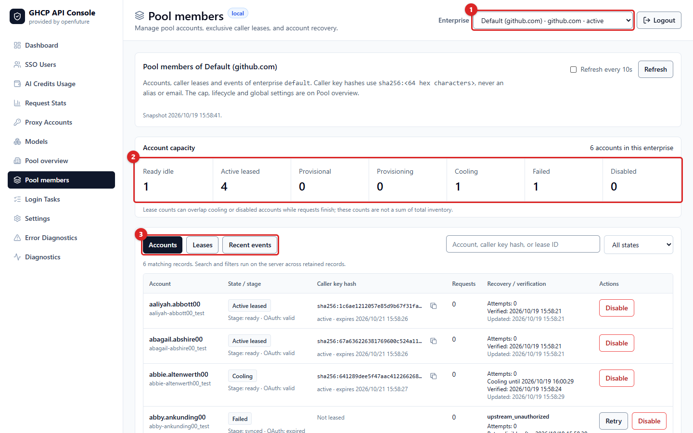

### 6.1 读懂一行

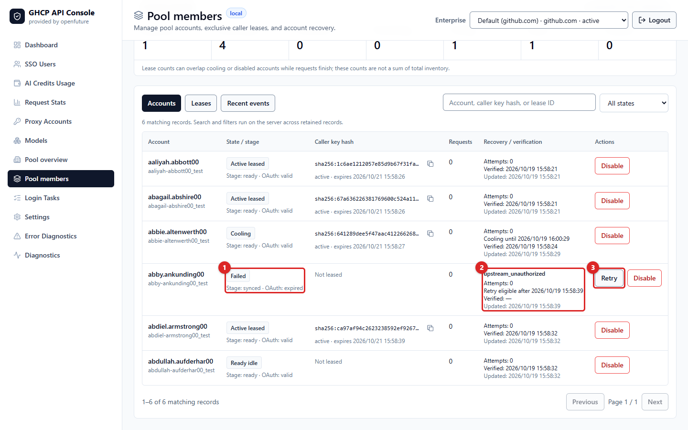

| 列 | 怎么读 |
| --- | --- |
| **State / stage**（图中 1） | 第一行是综合状态：`Ready idle`、`Active leased`、`Provisional`、`Provisioning`、`Cooling`、`Failed`、`Disabled`、`Catalog request`。下面一行 `Stage: <阶段> · OAuth: <凭据状态>`。阶段（`sso-creating`、`scim-syncing`、`seat-assigning`、`oauth-wait`、`warmup`、`ready` 等）用于分段执行和崩溃恢复，**不需要管理员逐个点击**。 |
| **Caller key hash** | 当前租用该账号的调用方 hash（缩略显示，悬停看全文），下面是 `active/provisional · expires <时间>`。`Not leased` 表示没有租约。 |
| **Requests** | 当前**正在进行**的请求数，不是历史总数。 |
| **Recovery / verification**（图中 2） | 最近错误代码、`Attempts`（当前这一轮开户/修复的失败次数）、`Cooling until`、`Retry eligible after`、`Verified`、`Updated`。 |

图中的成员经历了一次上游 401：状态变为 `Failed`，错误 `upstream_unauthorized`，`Stage: synced · OAuth: expired`。这时系统已结束该用户的租约（Recent events 中依次出现 `oauth_reauth_scheduled`、`lease_expired`），该用户下次请求会重新分配到其他空闲成员；失败成员本身排队自动重新授权。本环境开启了 Pause prewarming，所以修复被推迟，成员保持 `Failed`；取消暂停后它自动进入修复。

自动重试规则（源码）：失败后的重试等待时间为 30 秒起倍增、最长 300 秒；**Attempts 达到 3 次**或错误属于需要人工核对的类型（`sso_name_conflict`、`sso_creation_ambiguous`、`oauth_dispatch_ambiguous`、`oauth_task_cancelled_unconfirmed`）时不再自动重试。`Retry eligible after` 只表示时间门槛，不保证一定重试。

上游 429 会让成员进入 `Cooling`（`Cooling until` 由上游 `Retry-After` 决定）。冷却期间该成员的租约用户收到 429 `member_cooling`，**不会换账号**；冷却结束后自动恢复。

### 6.2 Retry（只对 Failed 成员显示）

步骤：点该行 **Retry**。

预期结果：提示 `<账号> queued for revalidation.`，成员回到 `Provisioning`，Attempts 清零，从原阶段继续。

- 有正在进行的请求时按钮不可用（服务端返回 409 `member_in_use`）。
- 错误属于上面四种需人工核对的类型时返回 409 `manual_reconciliation_required`：先确认外部的 SSO 用户 / 登录任务到底有没有完成，不要反复 Retry。
- 普通的首次 401 已有自动修复，一般不必手工 Retry；暂停时或 Attempts 已到 3 时才需要。

### 6.3 Disable

适用：某个账号需要人工调查、不应再接新请求。

步骤：点 **Disable**，在确认框中核对企业和账号，点 **Disable account**。

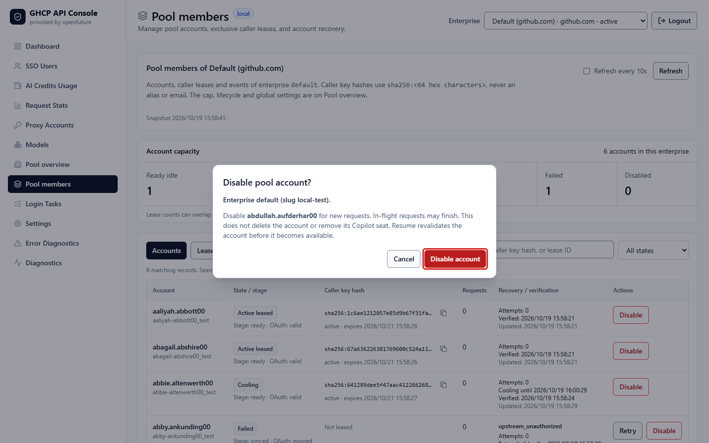

预期结果：

- 提示 `<账号> disabled. No new requests will use this account.`，状态变为 `Disabled`，按钮变为 **Resume**。
- 该账号没有进行中的请求时，它的租约立即删除，原用户下次请求会分到别的成员；有进行中的请求时，这些请求可以正常结束。
- **不删除** SSO/EMU 用户、凭据或 Copilot 席位，也不降低 GitHub 账单。

### 6.4 Resume（成员级，只对 Disabled 成员显示）

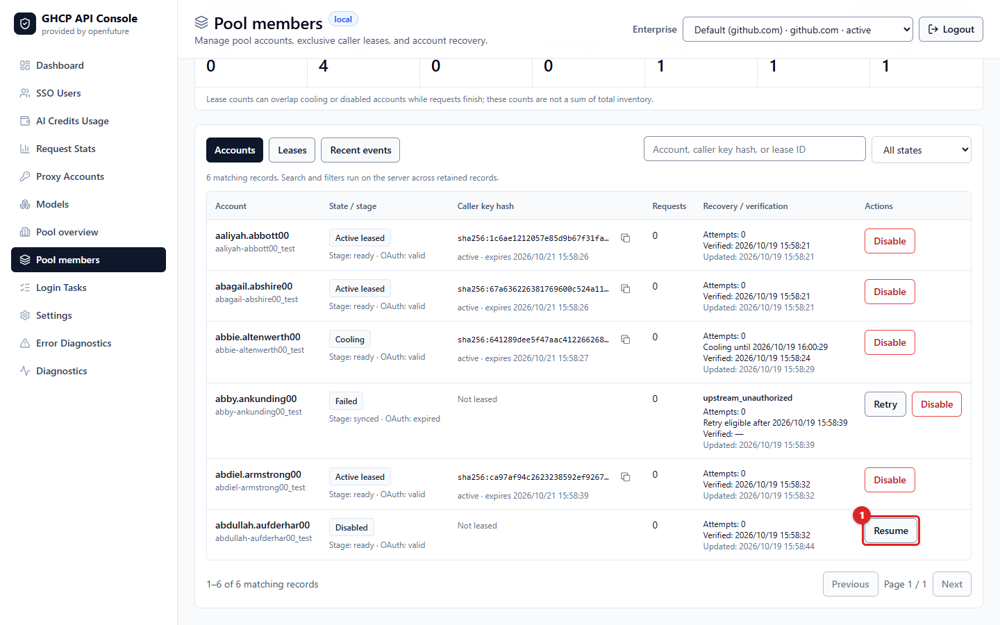

点 **Resume**：成员先重新验证（Provisioning → warmup），通过后才变为 `Ready idle`，不会直接可用。它不是 GitHub 账号的“解除挂起”，也不是企业级的 Resume。

常见错误：

- 想用 Disable 来“删除账号、退席位”：做不到，Disable 只是不再使用。
- 搜不到某个账号：先确认页头选的是该账号所属的企业；成员操作只作用于所选企业的成员。
- 看到计数相加不等于总数：租约计数和成员状态是两个维度，一个成员可以既有租约又在冷却，不要相加。

---

## 任务 7：查某个用户落在哪个企业、哪个账号，并释放租约

用户投诉时，管理员通常只知道“哪把 LiteLLM key”。Proxy 只认识这把 key 的 hash。

### 7.1 算出用户的 key hash

hash 就是 **virtual key 原文的 SHA-256**（UTF-8，小写十六进制），LiteLLM 发给 Proxy 时加上 `sha256:` 前缀。计算方法见[任务 11.2](#112-key-hash-与-x-user-identity)。如果你能在 LiteLLM 中看到该 key 的 hashed token，它就是同一个值，不需要再算。

### 7.2 在 Pool members 中搜索

1. 打开 **Pool members**，页头选择一个企业（通常先选 `default` 或主要企业）。
2. 切到 **Leases** 标签。
3. 在搜索框粘贴 64 位 hash（带不带 `sha256:` 都可以），搜索在服务端执行。
4. 找到后读出 **Account / lease**（账号名和租约 ID）、Phase、到期时间。
5. 搜不到时换下一个企业再搜。搜索只在所选企业内进行。

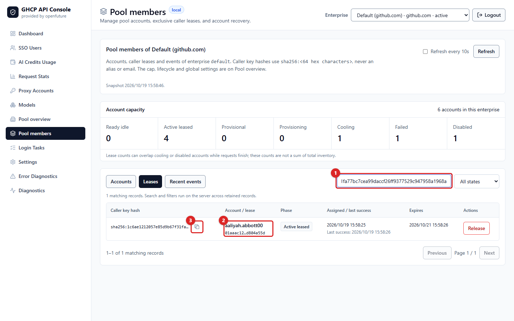

每个 hash 旁的复制图标（图中 3）复制不带 `sha256:` 的完整 64 位 hash，便于回到 LiteLLM 核对。在 **Accounts** 标签搜同一个 hash 也可以，能同时看到该账号的状态和恢复信息。

### 7.3 看这个用户的请求记录

**Request Stats** 按池成员（账号名）记录，不按 key hash 记录。用上一步得到的账号名过滤：

1. 打开 **Request Stats**，页头选同一个企业。
2. 点 **Filters**，在 **Exact identity** 填账号名，点 **Apply filters**。

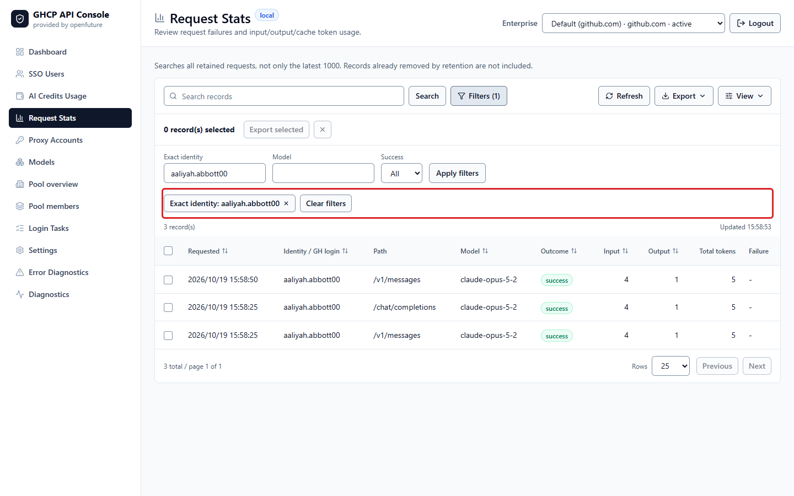

注意：同一个账号在不同时间可能服务过不同用户（租约释放后被别人领取），按时间段对照 Recent events 中的 `lease_acquired` / `lease_released`。

### 7.4 释放租约（Release）

适用：用户反映“一直在同一个坏账号上”，或要把用户从某个企业迁走。

步骤：在 **Leases** 标签点该行 **Release**，核对确认框中的企业、账号、hash 和租约 ID，点 **Release lease**。

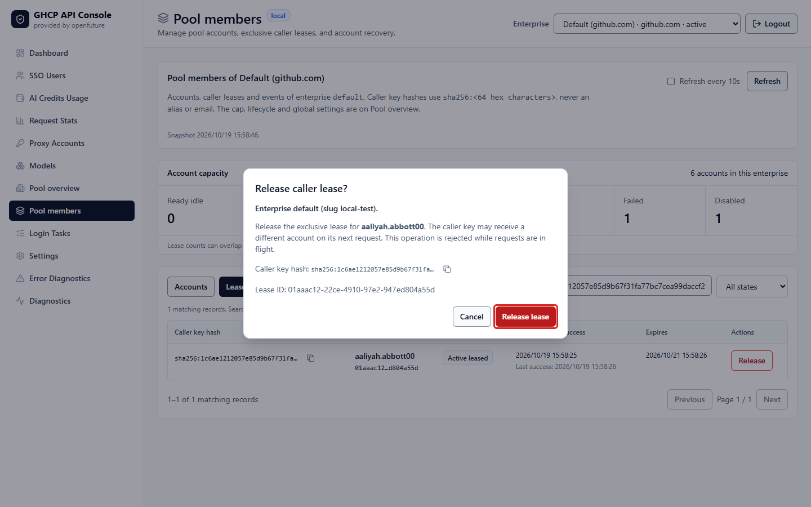

预期结果：提示 `Lease released. The caller key may acquire a different account on its next request.`。该用户下次请求重新分配：**可能是另一个账号，也可能是另一个企业**，也可能恰好是同一个空闲账号（本环境中就出现过）。

- 有进行中的请求时（Phase 下显示 `Requests in flight`）不能释放。
- Release 不撤销 LiteLLM key、不退席位。在 LiteLLM 撤销了 key，Proxy 中的租约也不会自动删除，等 TTL 到期或手工 Release。

### 7.5 Recent events

**Recent events** 标签解释“为什么这个账号/租约变了”，例如 `lease acquired`、`lease renewed`、`lease released`、`lease expired`、`member disabled`、`oauth reauth scheduled`、`enterprise policy updated`。只显示所选企业的事件。

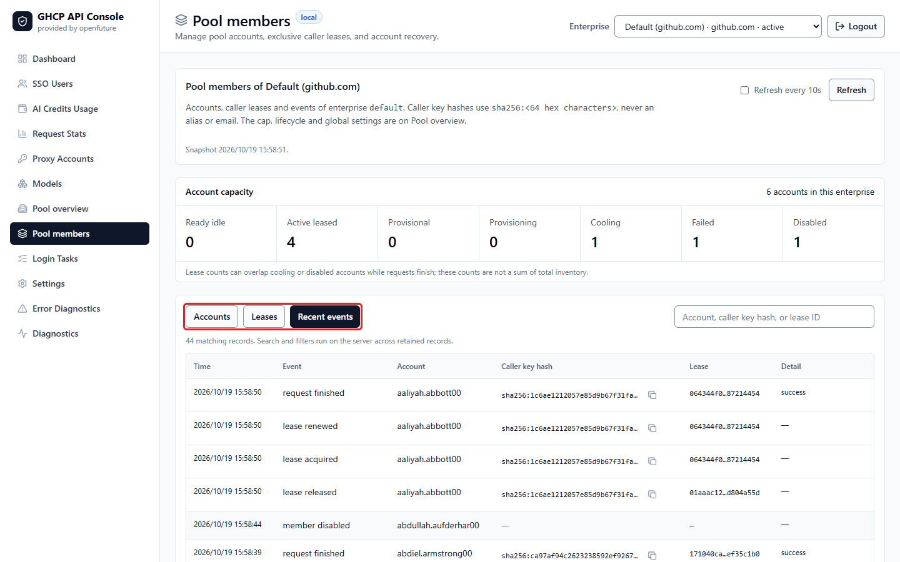

---

## 任务 8：SSO 用户、席位、Proxy 账号与登录任务

### 8.1 SSO Users

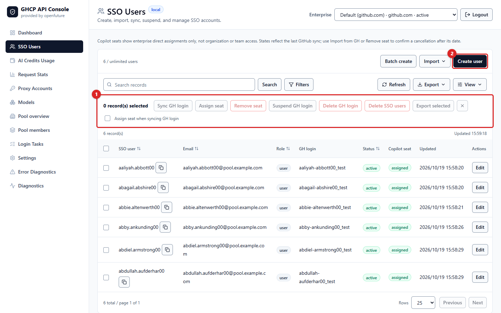

按企业列出 SSO 用户：SSO user、Email、Role、GH login、GitHub 状态、Copilot 席位、更新时间。左上角 `N / unlimited users` 是该企业 SSO 用户数和上限（上限在 **Settings → SSO runtime settings → Maximum SSO users** 设置，按企业）。

可用操作：

| 操作 | 位置 | 说明 |
| --- | --- | --- |
| Create user / Batch create | 右上角 | 新建普通 SSO 用户；达到上限时按钮不可用 |
| Import → Import CSV | 右上角 | CSV `ssoUser` 或 `ssoUser,password`；已存在的用户会更新密码 |
| Import → Import from GH | 右上角 | 先 **Preview alignment** 预览 GitHub SCIM 和企业直接分配的席位，再 **Apply safe changes** |
| Sync GH login、Assign seat、Remove seat、Suspend GH login、Delete GH login、Delete SSO users | 勾选后的批量操作（图中 1） | 红色按钮为破坏性操作 |
| Edit | 每行 | 改邮箱、密码、角色 |

**账号池成员受保护。** 由账号池创建的 SSO 用户（本图中的全部用户）不能通过这些普通入口修改密码/邮箱/角色、普通 Sync、删除 SSO 或 GH 账号、挂起或移除席位，会返回 `pool_member_managed: Manage this user through the user pool.`。请在 **Pool members** 用 Disable / Retry / Resume 管理。

Copilot seat 列只反映**企业直接分配**的席位（不含组织、团队授予），状态以最近一次与 GitHub 同步为准。

### 8.2 Proxy Accounts

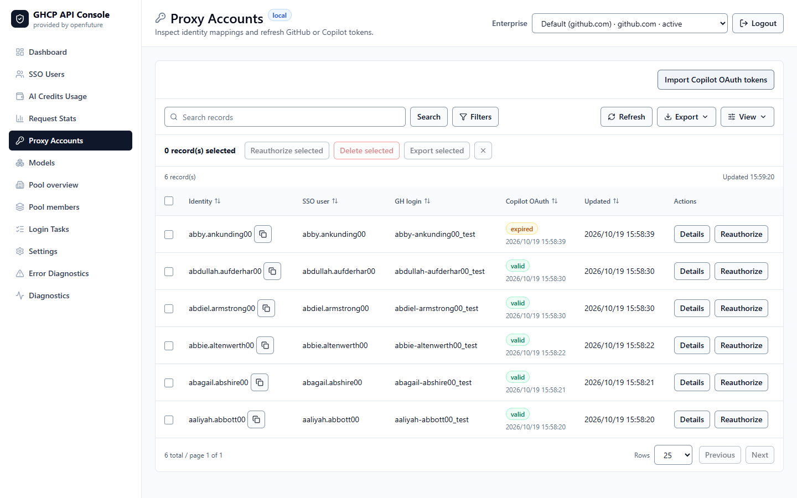

列出该企业 Proxy 中保存凭据的账号（包括池成员）：Identity、SSO user、GH login、Copilot OAuth 状态。**Details** 查看详情，**Reauthorize** 排队重新授权。账号池模式下，池成员的凭据由池自动维护：旧的 OAuth CSV 导入会被拒绝，池成员也不能用这里的独立重新授权并行登录，异常请在 Pool members 处理。

### 8.3 Login Tasks

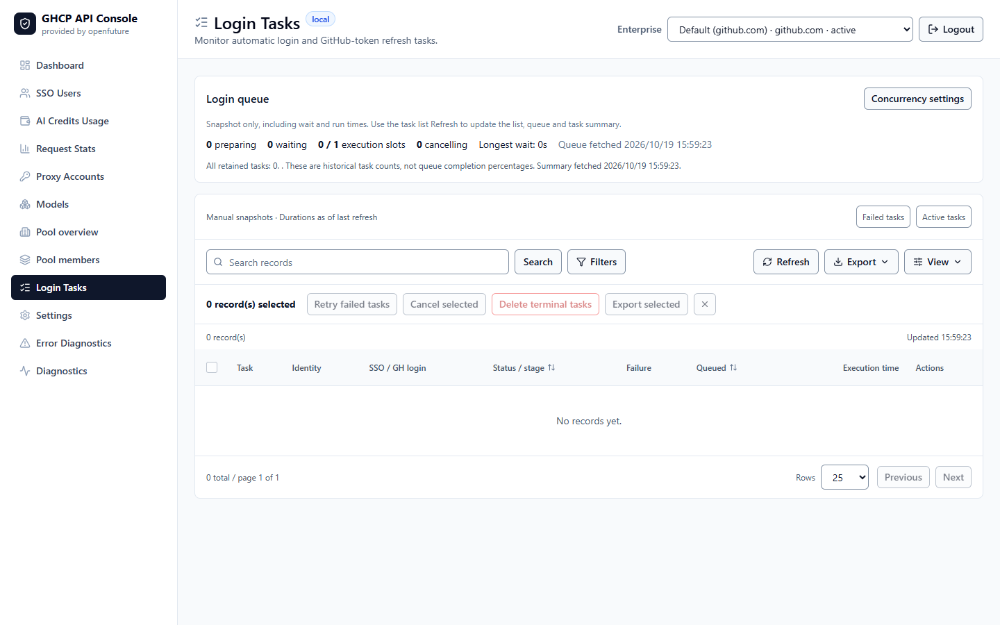

显示 Login 服务的自动登录任务队列（preparing / waiting / execution slots）和任务列表；快捷筛选 **Failed tasks**、**Active tasks**；**Concurrency settings** 跳到 Settings 的 Login 并发设置（全局，所有企业共用一个队列）。池成员的任务不能在这里单独 Retry。

> 截图说明：本手册的本地环境用 mock 代替真实 Login 执行浏览器登录，所以任务列表为空；生产环境中这里会出现每个池成员开户、修复时的登录任务。

---

## 任务 9：Models 页面

**Models** 按企业显示**该企业配置的 GitHub 企业管理员**能看到的 Copilot 模型目录。它不使用、不遍历任何池账号，也不会改用其他企业的管理员。

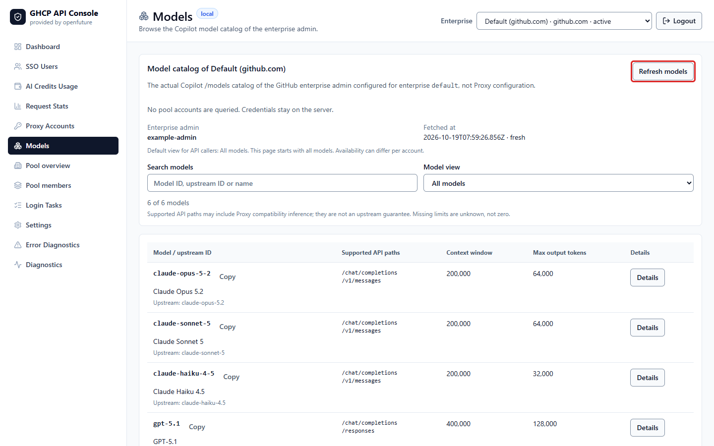

步骤：页头选企业 → 页面自动加载 → 可按模型 ID / 上游 ID / 名称搜索，或切换 **Model view** 只看 Messages 兼容的模型 → **Copy** 复制规范化的模型 ID → **Details** 查看元数据。**Refresh models** 绕过缓存重新查询（普通加载可命中 1 小时缓存，`Fetched at` 后显示 fresh / cached / stale）。

配置位置：

- `default` 企业：Proxy 环境变量 `MODELS_ADMIN_GITHUB_LOGIN`、`MODELS_ADMIN_GITHUB_USER_ID`（推荐）和 `MODELS_ADMIN_COPILOT_TOKEN_FILE`（推荐）或 `MODELS_ADMIN_COPILOT_TOKEN`。
- 其他企业：registry 中该企业的 `modelsAdmin`（`githubLogin`、`githubUserId`、`copilotToken` 引用），改动需重启 Proxy；token 文件每次查询重新读取，轮换无需重启。

未配置的企业显示：

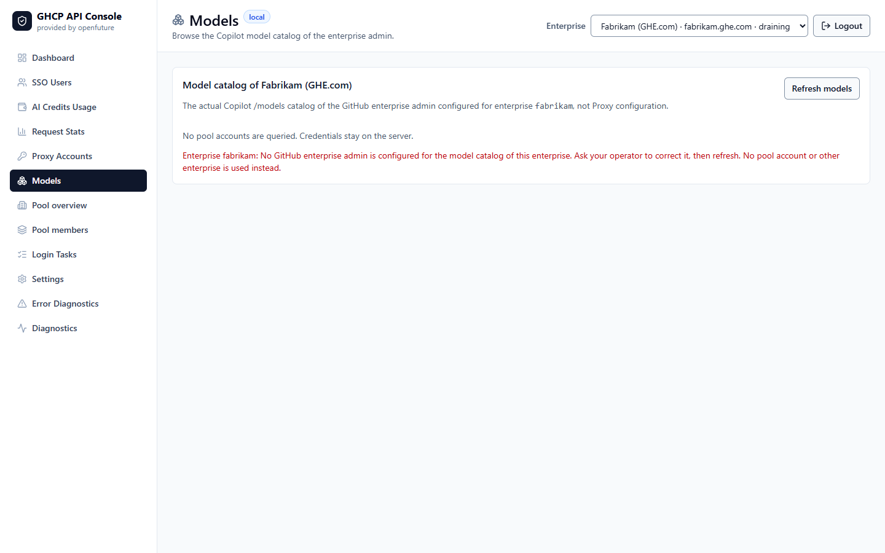

常见错误代码（详见 [Models 使用指南](../models-admin-guide.md)）：`models_admin_not_configured`（未配置）、`models_admin_credential_missing`（secret 文件不存在或为空）、`models_admin_identity_mismatch`（token 不属于配置的登录名/用户 ID）、`models_upstream_authorization_rejected`（Copilot 拒绝该管理员）、`models_upstream_rate_limited`（等待后再刷新）。

注意：目录代表“该企业该管理员账号”可见的模型，不代表企业内每个账号都相同，也不代表每个模型都做过推理测试。

---

## 任务 10：用户投诉时怎么看 Request Stats、AI Credits 和 Error Diagnostics

### 10.1 Request Stats

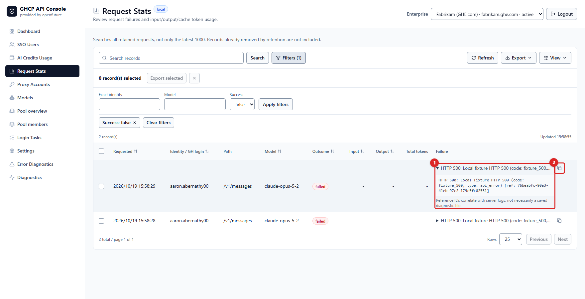

步骤：

1. 页头选企业；Dashboard 卡片上的 **Failed requests** 会直接带上 `Success = false` 筛选。
2. **Filters**：`Exact identity`（池成员账号名，见任务 7.3）、`Model`、`Success`。
3. **Failure** 列显示上游错误摘要，格式如 `HTTP 500: <message> (code: ..., type: ...) [ref: <UUID>]`；点 ▶ 展开全文，点复制图标复制整条。`ref` 可用于在 Proxy 日志或 Error Diagnostics 中关联同一次失败。
4. **Export** 导出筛选结果。

注意：

- 统计保留量受 Proxy 环境变量 `REQUEST_STATS_PER_ACCOUNT_LIMIT` 限制，**代码默认每个账号只保留最近 2 条**。排查历史请求前先确认部署中的这个值；完整请求历史以 LiteLLM SpendLogs 为准。
- Identity 是池成员账号，不是用户 key。

### 10.2 Error Diagnostics

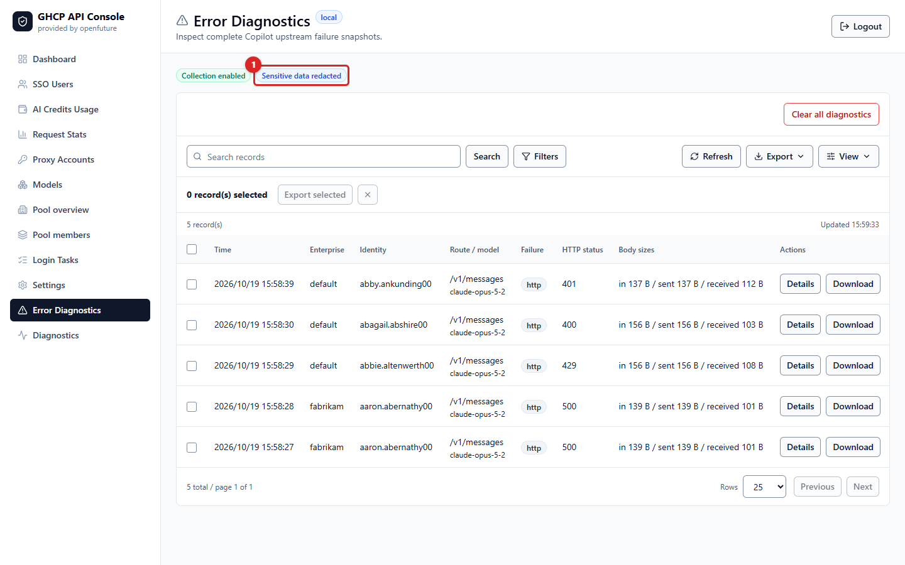

全局页面，列出 Proxy 保存的上游失败快照，每条注明所属企业、账号、路径/模型、HTTP 状态和请求/响应大小。**Details** 预览，**Download** 下载完整记录。

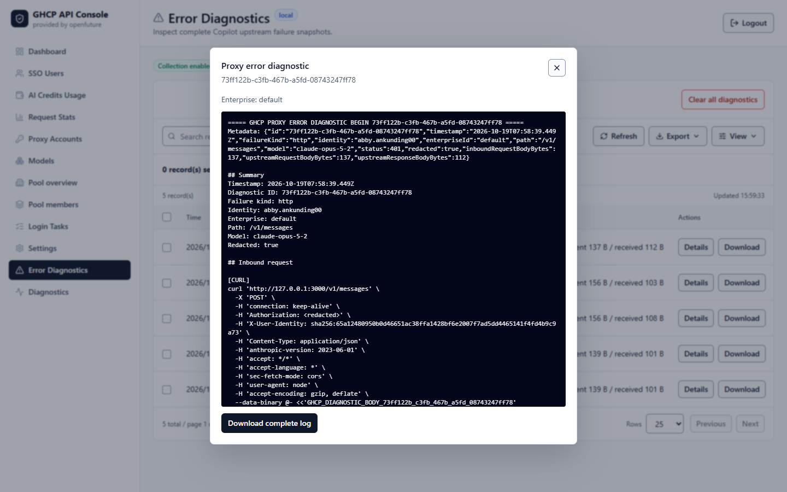

- 顶部徽章：`Collection enabled/disabled` 表示是否在采集，`Sensitive data redacted` / `Unredacted records` 表示是否脱敏（图中 1）。**代码默认开启采集且不脱敏**（`PROXY_ERROR_DIAGNOSTICS_ENABLED=true`、`PROXY_ERROR_DIAGNOSTICS_REDACT=false`）；生产模板通常关闭采集或开启脱敏，以部署配置为准。
- 即使脱敏，记录中仍有完整的调用方 hash（`X-User-Identity`）和请求内容摘要，只应让授权管理员访问，不要外发截图。
- **Clear all diagnostics** 清除**所有企业**的诊断记录，不只是筛选结果，不可撤销。

### 10.3 AI Credits Usage

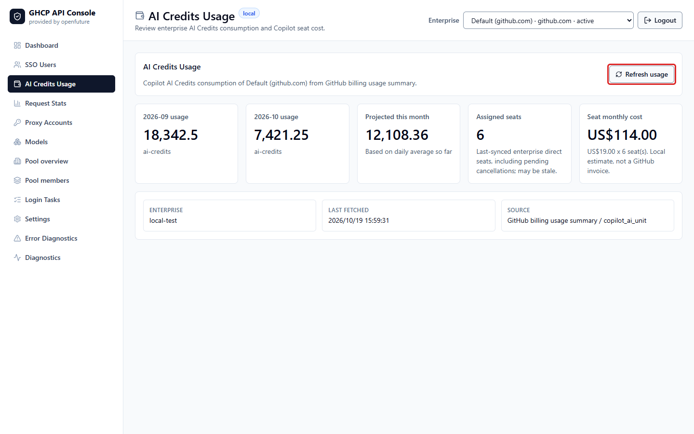

按企业显示 GitHub billing usage summary 中 `copilot_ai_unit` 的用量：上月、本月、按日均推算的本月预计值，以及已同步的企业直接分配席位数和按每席位每月 US$19 计算的**本地估算**席位成本（不是 GitHub 账单）。**Refresh usage** 重新向 GitHub 查询。该企业未配置 `sso.seatPat` 时刷新失败（`ai_credits_refresh_failed`）。

### 10.4 用户投诉时的排查顺序

1. 让用户提供出错时间、模型名和 LiteLLM 返回的错误码；管理员算出该 key 的 hash（任务 11.2）。
2. **Pool members** 按 hash 找到企业和账号（任务 7.2）。看该账号的 State、Recovery 列。
3. **Request Stats** 按账号名 + `Success = false` 过滤，看 Failure 摘要。
4. 需要完整上游响应时，到 **Error Diagnostics** 按时间、企业、账号找对应记录。
5. 按任务 12 的速查表处理。

---

## 任务 11：LiteLLM 侧（没有界面）

GHCP 通过 LiteLLM 的回调 Hook 接入。仓库提供两个文件（放在 LiteLLM 进程可导入的同一目录）：

- [`litellm/user_pool_hook.py`](../../litellm/user_pool_hook.py)：身份 Hook，所有通过认证的业务 key 都可以使用 GHCP。
- [`litellm/user_pool_canary_hook.py`](../../litellm/user_pool_canary_hook.py)：灰度 Hook，在身份 Hook 基础上只放行 hash 首位属于指定集合的 key。

LiteLLM 配置 `callbacks` 中**二选一**注册（`user_pool_hook.proxy_handler_instance` 或 `user_pool_canary_hook.proxy_handler_instance`），不要同时注册。详细说明见 [LiteLLM 身份接入](../user-pool-litellm.md) 和 [灰度 Hook](../user-pool-litellm-canary.md)。

### 11.1 扩大灰度范围：`ALLOWED_HASH_PREFIXES`

在 `user_pool_canary_hook.py` 顶部：

```python
ALLOWED_HASH_PREFIXES = "0"
```

每个字符代表 **hash 第一位**允许的一个十六进制值（不是多字符前缀）：

| 值 | 放行的 key | 理论比例 |
| --- | --- | --- |
| `"0"`（仓库默认） | hash 首位为 0 | 6.25% |
| `"012"` | 首位为 0、1、2 | 18.75% |
| `"01234567"` | 首位为 0–7 | 50% |
| `"0123456789abcdef"` | 全部业务 key | 100% |
| `""` | 不放行任何业务 key 进入 GHCP | 0% |

步骤：

1. 修改常量（只能用小写十六进制字符；`"0-2"`、逗号、百分比都无效，无效值会让 LiteLLM 启动失败）。
2. 按正常发布流程更新所有 LiteLLM 副本（例如滚动更新 Pod）。**不支持热加载**，只改挂载文件不会生效；滚动期间不同副本的放行集合会短暂不同。
3. 不需要改 GHCP 镜像、数据库、租约，也不需要重新生成 virtual key。

注意：比例按 key 计算，不是按人数或流量；不要为了“抽中”而给用户多发 key。放行只是**允许**选择 GHCP，仍由 LiteLLM 原路由策略在健康候选中选择；收紧范围不会删除已有成员或释放已有租约。

### 11.2 key hash 与 `X-User-Identity`

Hook 从 LiteLLM 服务端认证对象中取该 virtual key 的 hashed token（即原始 key 的 SHA-256，64 位小写十六进制），只在发往 GHCP 的请求上设置：

```http
Authorization: Bearer <GHCP Proxy 的服务密钥>
X-User-Identity: sha256:<64 位小写十六进制>
```

不二次 hash，不使用 alias、邮箱或请求中的 metadata；客户端自己填的身份头在 GHCP 路径上会被清除。key 改 alias 不改变 hash；换 key 就是新的调用方。

管理员计算某把 key 的 hash（只在受控的终端中操作，不要把原始 key 留在共享的命令历史里）：

```sh
# Linux / macOS：printf 不会追加换行，echo 会，结果就不对了
printf '%s' 'sk-example-alice-0001' | sha256sum
```

```powershell
# Windows PowerShell
$k = 'sk-example-alice-0001'
-join ([Security.Cryptography.SHA256]::Create().ComputeHash([Text.Encoding]::UTF8.GetBytes($k)) | ForEach-Object { $_.ToString('x2') })
```

```sh
python3 -c "import hashlib,sys; print(hashlib.sha256(sys.argv[1].encode()).hexdigest())" 'sk-example-alice-0001'
```

示例：`sk-example-alice-0001` 的 hash 是 `1c6ae1212057e85d9b67f31fa77bc7cea99daccf26ff9377529c947958a1968a`，即 Console 中的 `sha256:1c6ae121…58a1968a`（任务 7 的截图就是用它搜索的）。灰度 Hook 判断的就是这个 hash 的第一位（此例为 `1`，在默认 `"0"` 下不放行）。

### 11.3 两个 403 错误码

| 错误码 | 什么时候出现 | 处理 |
| --- | --- | --- |
| `ghcp_canary_not_allowed` | 灰度 Hook：调用方 hash 首位不在 `ALLOWED_HASH_PREFIXES` 中，而该模型组过滤掉 GHCP 后没有其他后端；或者 fallback / 直接指定 deployment 想发往 GHCP | 属预期的灰度拒绝。要放行就扩大 `ALLOWED_HASH_PREFIXES` 并更新 LiteLLM；或给该模型组配置可用的非 GHCP 后端 |
| `ghcp_pool_trusted_identity_required` | 请求要发往 GHCP，但没有可信的业务 virtual key 身份：例如用 Master Key、UI session token、JWT 或自定义认证调用，或认证对象中的 hash 不合法/不一致 | 让用户使用正常的业务 virtual key 调用；Master Key 只能走模型组中的非 GHCP 后端 |

LiteLLM 可能会重新包装错误正文，客户端看到的格式以所用 LiteLLM 版本为准。这两个错误都发生在 LiteLLM 内、请求到达 GHCP 之前，所以 Console 里看不到对应记录。

---

## 任务 12：故障排查速查表

| 现象 | 先看哪里 | 处理 |
| --- | --- | --- |
| 新用户都收到 429 `pool_exhausted` | Pool overview：Attention needed、各企业 Ready idle 和 Inventory/cap | 是否暂停；`active` 企业是否都到 cap；空闲成员是否只在 `draining` 企业。提高 cap / 激活企业 / 取消暂停后等待补货 |
| 某用户反复 429 `member_cooling` | Pool members：按 hash 找到账号，看 `Cooling until` | 上游限流冷却，等到期自动恢复；不要为绕过限流而 Release |
| 某用户 503 `member_unavailable` | Pool members：该用户账号状态 | 账号 Failed/Disabled 且仍有租约（例如禁用时有请求在进行）。等修复，或 Release 让用户换账号 |
| 某用户 503 `enterprise_draining` | Pool overview：State 列 | 该用户只持有排空企业的目录请求占用。等 Retry-After 后重试；需要时 Resume 企业 |
| LiteLLM 返回 403 `ghcp_canary_not_allowed` / `ghcp_pool_trusted_identity_required` | LiteLLM 配置（任务 11.3） | 扩大灰度或改用业务 key |
| 企业 Activate 失败，`Not changed: ... Readiness blockers: ...` | Pool overview：Blockers | 按任务 3.4 逐项处理，重启相应服务 |
| 新企业 Blockers 为 `sso_missing` / `login_missing` | 哪个服务没重启 | 用同一份 registry 重启 SSO / Login |
| 服务启动失败 `enterprise_identity_changed` | 服务日志 | 把 registry 中的身份字段改回原值；不要删卷或改库绕过 |
| 服务启动失败 `enterprise_registry_invalid` / `enterprise_env_conflict` | 服务日志中的字段路径 | 修正 registry；`default` 的同名字段与环境变量保持一致或留空 |
| Pool members 中成员 Failed、`upstream_unauthorized` | 该行 Recovery 列、Recent events | 正常会自动重新授权；暂停时不会，取消暂停或手工 Retry |
| Retry 返回 `manual_reconciliation_required` | 该行错误代码 | 先核对外部 SSO 用户 / 登录任务的实际结果，不要反复 Retry |
| Failed 成员 Attempts 已到 3 | Recovery 列 | 不再自动重试。查明原因后手工 Retry |
| Low idle capacity 一直不消失 | 企业表 Inventory/cap、Provisioning | 所有 `active` 企业到 cap 时不会再补货；提高 cap 或调低目标 |
| 选择器中的企业状态和企业表不一致 | — | 浏览器刷新（选择器列表只在页面加载时读取） |
| 按企业页面显示 `Enterprise "<id>" is not configured in Proxy` | 地址栏 `e=` | 选一个存在的企业 |
| Models 显示 `models_admin_not_configured` 等 | 任务 9 | 配置该企业的 Models 管理员 |
| AI Credits 刷新失败 | 该企业 `sso.seatPat` | 配置席位 PAT |
| Console 写操作返回 403 `cross_site_request_rejected` | 访问地址与反向代理 | 设置 `CONSOLE_PUBLIC_BASE_URL` 为浏览器访问的 Console 地址 |
| SSO 用户操作返回 `pool_member_managed` | 该用户是池成员 | 在 Pool members 管理 |
| Request Stats 只看到很少记录 | `REQUEST_STATS_PER_ACCOUNT_LIMIT` | 默认每账号 2 条；按需调大（所有 Proxy 一致），完整历史看 LiteLLM SpendLogs |

---

## 附录 A：本手册核对过的行为

除了阅读源码，下列行为在本地隔离环境中实际执行过（截图脚本运行时会在日志里打印 `check:` 行）：

- 新企业以 `draft` 出现、cap 为 `initialMaxAccounts`；缺 secret 文件时 Blockers 为 `sso:enterprise_secret_unconfigured:sso.signingKey`，Activate 返回 `Not changed`；补文件并重启 SSO 后变为 `None`。
- 全局目标 6、caps 6/4 时，补货后两个企业 Target share 与 Actual share 均为 60% / 40%。
- 上游 401：成员 `Failed` + `upstream_unauthorized`，事件 `oauth_reauth_scheduled`、`lease_expired`；暂停期间保持 Failed，取消暂停后进入修复。上游 429：成员 `Cooling`，`Cooling until` 为 `Retry-After` 之后。
- Drain 后：原租约请求返回 200；释放该租约后同一用户返回 429 `pool_exhausted`（`active` 企业无空闲，排空企业有 4 个空闲也不使用）；全新用户同样 429。
- 按 64 位 hash 在 Leases 中搜索命中；Release 后下一次请求重新分配。

未在本环境验证、只依据源码和既有文档描述的部分：LiteLLM Hook 的实际运行（任务 11，依据 Hook 源码与仓库的 Hook 测试）、真实 GitHub/GHE.com 的 SAML/SCIM/席位/登录（mock 代替）、Login Tasks 的真实任务列表（mock 代替了 Login 的浏览器登录）。

## 附录 B：刷新截图

界面改动后可以重新生成全部截图：

```sh
npm ci
npm run build:deploy
node docs/admin-manual/capture-screenshots.mjs
```

- 脚本在本机以普通进程启动构建好的 Proxy、SSO、Login、Console（SQLite），以及仓库的 mock（`tests/docker-user-pool/mock-services.mjs`）和 `docs/admin-manual/tools/edge-mock.mjs`（补充 AI Credits 用量与 Models 管理员目录两个 mock 接口），用无头 Microsoft Edge（Playwright，`AM_BROWSER_CHANNEL=chrome` 可改用 Chrome）按本手册的场景操作并截图到 `docs/admin-manual/images/`，结束后停止全部进程。
- 每个进程都预加载 `docs/admin-manual/tools/dns-shim.mjs`：只解析 `proxy`、`sso`、`login`、`mock`、`localhost` 和 `*.ghe.com`（全部指向 127.0.0.1），其他主机名一律解析失败，并把所有监听地址强制为 127.0.0.1。因此脚本不会访问真实 GitHub、GHE.com、Copilot 或任何模型，也不对外暴露端口。
- 需要：Node 22+；PATH 中有 `openssl`（Git for Windows 自带，用于生成一次性 SAML 签名证书）；本机端口 80、3000、7001、7003、7004、8002 空闲。不使用 Docker。
- 运行目录 `.claude/admin-manual-run/capture/`（已被 git 忽略）每次重建，包含 SQLite、合成 secret、日志；`--keep-env` 参数可让服务在截图后继续运行，便于手工查看（Ctrl+C 停止）。
- 截图使用 1440×900 视口；Pool overview 页面的截图为 1760 宽以完整显示企业表，整页图按页面高度截取（不用 Playwright 的 fullPage 拼接，避免吸顶页头错位）；时区 Asia/Shanghai。
